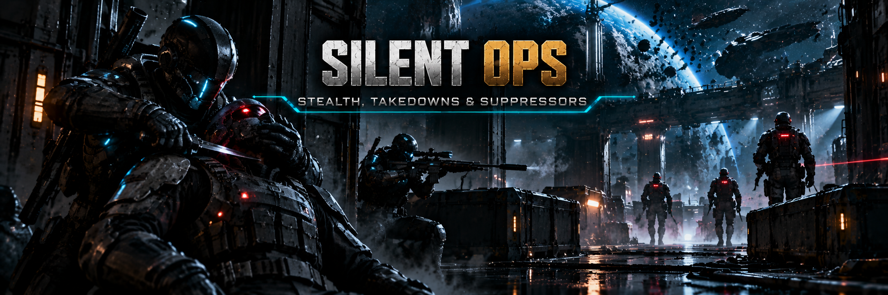

# Silent Ops — realistic stealth for SpaceBourne 2

Enemies no longer spot you the instant you enter their view, from any distance. Up close and in
plain view you are seen at once; farther away they notice you gradually, depending on distance,
where they are looking, your stance, how fast you move, your flashlight and how well trained they
are. Gunshots carry and put enemies on edge, a suppressed pistol thumps instead of cracking, a knife
from behind kills silently, and your squad can follow you quietly without opening fire.

Version 0.3.4 · [Nexus Mods page](https://www.nexusmods.com/spacebourne2/mods/6) · UE4SS Lua mod · works alone or with
[Hardcore Tactical Realism](https://github.com/hubertdungen/SpaceBourne2-HardcoreTacticalRealism).

## What it does

- **Suspicion before alarm.** An unaware enemy builds a suspicion meter instead of spotting you
  at once. Suspicious enemies stop and turn to look; at higher suspicion they walk over to check;
  when the meter fills they raise their weapon and combat starts.
- **Alert levels.** Every enemy is Blue (relaxed), Green (normal attention), Yellow
  (suspicious), Orange (danger known) or Red (combat). Levels rise and fall with evidence, and
  sharpen or dull sight and hearing. From Yellow an enemy raises its weapon and aims where it
  suspects you; it fires only at Red.
- **Realistic sight.** Standing a few metres in front of an enemy is combat at once. Far away it
  sees "something" and walks over to look before it is sure. Crouching is not invisibility: in
  the open you are still noticed, only slower. What hides you is cover: how much of your head,
  chest and knees it can see, and a wall behind you breaking your outline. Moving draws the eye,
  the flashlight gives you away. Side vision is weaker; enemies do not see behind them.
- **Training.** Militia notice you slower and hesitate before firing; elites notice faster and
  react almost at once. Harder, not impossible.
- **Gunshots by weapon class.** Pistol < SMG / rifle < shotgun < DMR < sniper < grenade: how far
  each is heard (45–120 m, half through walls) and how alarming it is. Shots add up. Enemies who
  heard enough draw their weapons, search towards the sound and fire at the first movement.
  Every NPC's gunfire counts too: a fight in the next room alerts them, and two rooms away they
  come to check (trained ones with the weapon drawn).
- **Witnesses.** See a mate shot dead: weapon drawn, calls the others, maybe crouches for cover.
  Find a body without hearing anything: searches and calls for help. Wounded or dying enemies cry
  out and mates come to check. A silent takedown makes no cry.
- **Suppressors on pistols.** Fitting one takes 3.5 s (no shooting meanwhile). Enemies hear the
  shot as "something odd" ~12 m away instead of an alarm 45 m away, and you hear it a little
  quieter. The pistol gets a little less accurate and its bullet a little slower. Remembered per
  weapon.
- **Silent takedowns.** A melee hit from behind on an unaware enemy kills at once, without an
  alarm. From the front or the side it is a normal hit and the enemy shouts for help.
- **Searching and losing them.** Break line of sight long enough and alerted enemies lose you,
  but they keep hunting with weapons drawn before they go back to patrol.
- **Turrets and grenades.** Setting up a turret makes noise and a firing turret is loud; a
  grenade blast is heard 120 m away.
- **Quiet squad orders.** Follow quietly (crouched, no firing), Hold (stay put, hold fire) or
  Weapons free. Spotted while quiet? The squad opens fire on its own.
- **On by default.** Switch it off for a moment with a key; it is on again at the next start.

## Requirements

- SpaceBourne 2 (Steam).
- [UE4SS 3.0.1](https://github.com/UE4SS-RE/RE-UE4SS/releases/tag/v3.0.1). Installing HTR
  installs it too.
- Recommended: [Hardcore Tactical Realism](https://github.com/hubertdungen/SpaceBourne2-HardcoreTacticalRealism)
  0.4.2 or later. Silent Ops then uses HTR's relaxed / alert sight per faction, and HTR handles
  damage, aim and combat once an enemy is alerted.

## Install

1. Download `SilentOps-0.3.4.zip` from the
   [releases](https://github.com/hubertdungen/SpaceBourne2-SilentOps/releases).
2. Extract it into the game folder
   (`...\steamapps\common\SpaceBourne 2\`). It adds
   `SB2\Binaries\Win64\Mods\SilentOps\` (the `enabled.txt` inside turns it on).
   Updating: extract over it and let it replace the files.
3. Play. Stealth is on; **Shift+F4** on foot switches it off for the session.

Manual install: copy the `SilentOps` folder from this repository into
`SpaceBourne 2\SB2\Binaries\Win64\Mods\`.

Uninstall: delete `SB2\Binaries\Win64\Mods\SilentOps`.

## Keys (on foot)

| Key | Gamepad | Action |
|---|---|---|
| **Shift+F4** | flashlight button ×4 | Stealth on / off (for this session) |
| **F4** | flashlight button ×4, crouched | Fit / remove a suppressor on the pistol in your hands |
| **F3** | flashlight button ×2 | Squad order: Follow quietly → Hold → Weapons free |

F3 and F4 are the only F keys the game leaves free on foot (it uses F1, F2 and F5 for squad
orders, F6 quick save, F8 quick load, F10 bug report). Plain F3 / F4 stay quiet while Shift is
held. All keys can be changed in `scripts\config.lua`.

Gamepad: press the flashlight button quickly. An even number of presses leaves the light as it
was (two presses is a short flash, like a signal to your squad).

## Settings

Edit `Mods\SilentOps\scripts\config.lua` (every line is optional). The main ones:

- `Enabled`, `RememberToggle` — on at start; keep the last on/off between sessions instead.
- `Detection` — sight range source (HTR's per-faction relaxed sight, or a fixed range), the
  "combat at once" distances, stance, movement and flashlight factors, how much suspicion
  sharpens the senses, training (how fast each class notices and reacts), how long enemies
  search.
- `Noise` — hearing radius and alarm per weapon class, suppressed pistol, footsteps, cries,
  turrets, grenades.
- `Suppressor` — which weapons can take one (pistols), its spread and bullet-speed cost.
- `Takedown` — allowed melee weapons (knife and sword yes, hammer no), reach, "from behind" angle.
- `Witness` — how witnesses and body finders react and how far they call for help.
- `Allies` — order key, auto weapons free when spotted.
- `Gamepad`, `Hud` — the flashlight-button combos; which on-screen messages are shown.

## Status and known limits

0.3 was tested in game on 2026-10-31 with HTR 0.4.8: the alert levels, crouching noticed in the
open, weapon posture, the suppressor fitting time, and frame times (98 fps with 8 enemies around,
no measurable cost). 0.2 was tested with HTR 0.4.7. Each of these worked:

- combat at once up close, and noticing at 20 m and 32 m;
- unseen when crouched at 15 m;
- gunshots adding up and enemies hunting with their weapon drawn;
- the suppressed pistol, and the suppressor's spread and bullet speed;
- witnesses of a kill and a found body;
- the silent takedown without a cry;
- the turret and the grenade;
- the gamepad combos and the quieter messages;
- frame times: no measurable cost (53 vs 54 fps with 8 enemies around).

0.3.2's silent HUD lines were tested on 2026-11-06 through Ammo Discipline 0.1.2, which uses
the same line code: no beep, the line still on screen after 3 s, a repeat skipped.

0.1 tested the keys, takedowns, losing enemies and the squad orders (2026-10-30).

Not tested yet:

- a real knife swing (the takedown was tested with the same damage call the knife makes);
- a real gamepad (the button's input event was triggered directly);
- the squad's quiet follow walk over long distances;
- companions.

Bosses and robot tanks keep their vanilla behaviour.

Known limits:

- There is no real light or shadow model (the game gives no light level to mods); only your
  flashlight counts.
- An enemy that spawns right in front of you can still spot you instantly (vanilla).
- No new animations: takedowns use the normal melee swing, which the game shows in third person.
- The game has no suppressed shot sound: the pistol's own shot plays very quietly with a
  muffled thump on top. There is no visible suppressor on the pistol yet.
- A grenade's blast is placed about 15 m ahead of where you aimed, 1.5 s after the launch (the
  game gives mods no way to follow the grenade itself).
- No light level: the game gives mods none, and measuring the picture's brightness would cost
  frames.

Design notes, research and the full test log: [DESIGN.md](DESIGN.md).

## Part of the SpaceBourne 2 realism set

Separate mods that work alone or together:

| Mod | Status |
|---|---|
| **Hardcore Tactical Realism (HTR)** — realistic ballistics and tactical AI | released: [GitHub](https://github.com/hubertdungen/SpaceBourne2-HardcoreTacticalRealism) · [Nexus Mods](https://www.nexusmods.com/spacebourne2/mods/4) · [Steam discussion](https://steamcommunity.com/app/1646850/discussions/0/573805072991123580) |
| **SB2 HOTAS** — real joystick, HOTAS, rudder pedals and head tracking | released: [GitHub](https://github.com/hubertdungen/SpaceBourne2-HOTAS) · [Nexus Mods](https://www.nexusmods.com/spacebourne2/mods/8) |
| **Split Controls** — separate invert for ship and on foot | released: [GitHub](https://github.com/hubertdungen/SpaceBourne2-SplitControls) · [Nexus Mods](https://www.nexusmods.com/spacebourne2/mods/5) |
| **Silent Ops** — realistic stealth (this mod) | released: [GitHub](https://github.com/hubertdungen/SpaceBourne2-SilentOps) · [Nexus Mods](https://www.nexusmods.com/spacebourne2/mods/6) |
| **Gear Without Levels** — use gear regardless of level | released: [GitHub](https://github.com/hubertdungen/SpaceBourne2-GearWithoutLevels) · [Nexus Mods](https://www.nexusmods.com/spacebourne2/mods/7) |
| **Faction Power** — your faction gains power from dungeons, sales and missions | released: [GitHub](https://github.com/hubertdungen/SpaceBourne2-FactionPower) · [Nexus Mods](https://www.nexusmods.com/spacebourne2/mods/9) |
| Tactical Engineering — turrets | coming |
| Tactical First Person | coming |

One installer for the whole set is planned.

## License

MIT. See [LICENSE](LICENSE).
